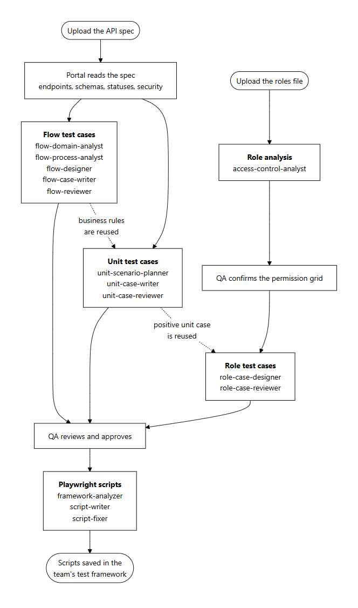
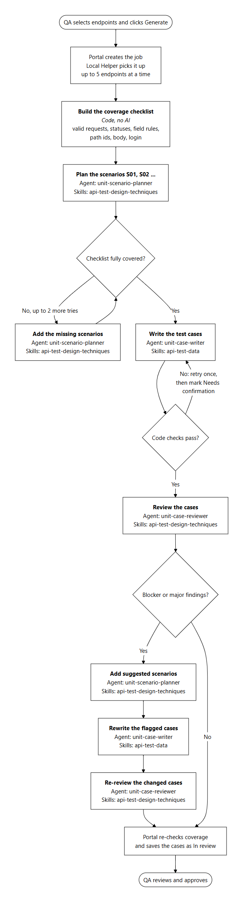
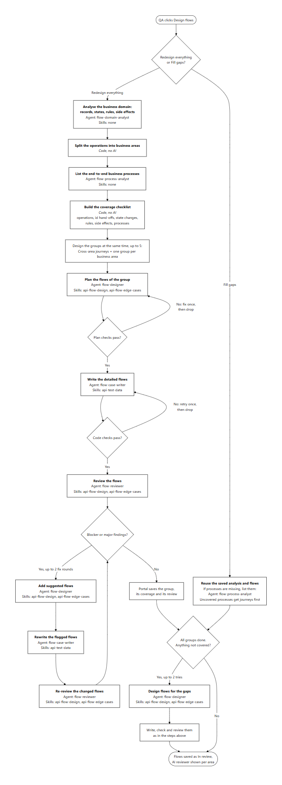
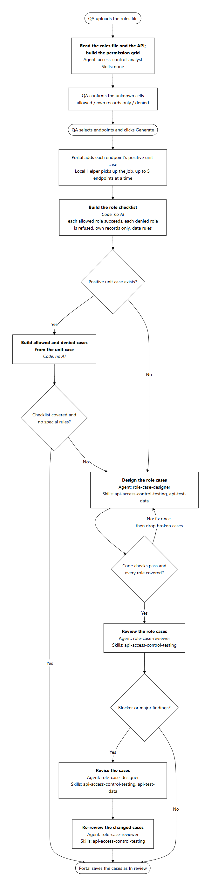
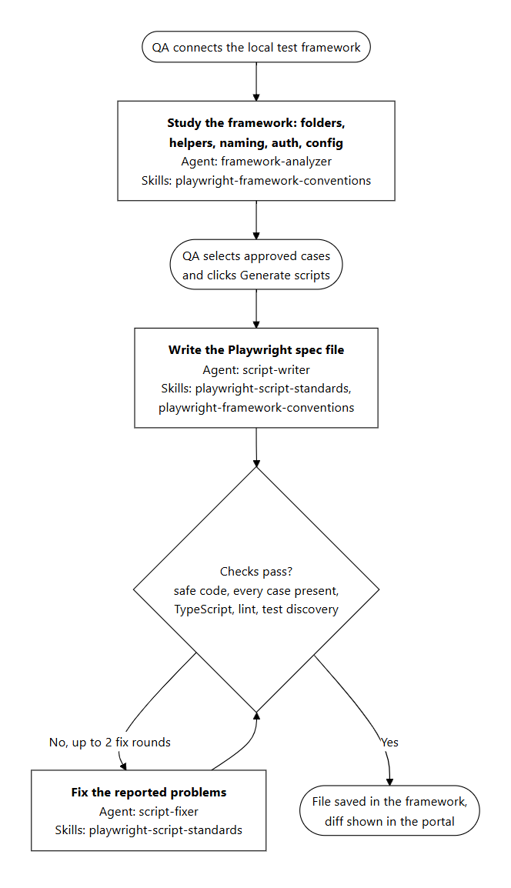

# How test cases are generated

This document shows, step by step, how API Test Studio generates unit, flow and role test cases, and
then Playwright scripts. Each step names the agent that does it and the skills that agent uses.
Steps marked **Code, no AI** are done by the application itself.

Agents are in `claude/agents/`, and skills in `claude/skills/`. The Local Helper on the QA
engineer's computer runs every step; the portal stores the results.

## Agents and skills

| Agent | Used for | Skills |
|---|---|---|
| unit-scenario-planner | Unit: plan the scenarios | api-test-design-techniques |
| unit-case-writer | Unit: write the cases | api-test-data |
| unit-case-reviewer | Unit: review the cases | api-test-design-techniques |
| flow-domain-analyst | Flow: analyse records, states, rules | none |
| flow-process-analyst | Flow: list the business processes | none |
| flow-designer | Flow: plan the flows | api-flow-design, api-flow-edge-cases |
| flow-case-writer | Flow: write the detailed flows | api-test-data |
| flow-reviewer | Flow: review the flows | api-flow-design, api-flow-edge-cases |
| access-control-analyst | Role: build the permission grid | none |
| role-case-designer | Role: design the role cases | api-access-control-testing, api-test-data |
| role-case-reviewer | Role: review the role cases | api-access-control-testing |
| framework-analyzer | Scripts: study the test framework | playwright-framework-conventions |
| script-writer | Scripts: write the spec file | playwright-script-standards, playwright-framework-conventions |
| script-fixer | Scripts: fix failing checks | playwright-script-standards |

---

## 1. End to end

- **Unit and flow cases** both start from the uploaded API spec.
- **Role cases** need the roles file, a confirmed permission grid and, where one exists, the
  endpoint's positive unit case.
- **Unit cases reuse the flow analysis.** When it exists, its business rules for that endpoint are
  passed to the unit planner.
- **Only approved cases** are turned into Playwright scripts.

---

## 2. Unit test cases

| # | Step | Done by | Skills |
|---|---|---|---|
| 1 | Build the coverage checklist from the spec | Code, no AI | – |
| 2 | Plan the scenarios (S01, S02 …) | unit-scenario-planner | api-test-design-techniques |
| 3 | Add scenarios for anything not covered (up to 2 tries) | unit-scenario-planner | api-test-design-techniques |
| 4 | Write the test cases | unit-case-writer | api-test-data |
| 5 | Check each case; retry failures once, then mark **Needs confirmation** | Code, no AI | – |
| 6 | Review the cases | unit-case-reviewer | api-test-design-techniques |
| 7 | For blocker or major findings: add suggested scenarios | unit-scenario-planner | api-test-design-techniques |
| 8 | Rewrite the flagged cases | unit-case-writer | api-test-data |
| 9 | Re-review only the changed cases | unit-case-reviewer | api-test-design-techniques |
| 10 | Re-check coverage and save as **In review** | Portal | – |

Up to 5 endpoints are processed at the same time. Each is saved as soon as it finishes.

---

## 3. Flow test cases

| # | Step | Done by | Skills |
|---|---|---|---|
| 1 | Analyse the business domain: records, states, rules, side effects | flow-domain-analyst | none |
| 2 | Split the operations into business areas | Code, no AI | – |
| 3 | List the end-to-end business processes | flow-process-analyst | none |
| 4 | Build the coverage checklist | Code, no AI | – |
| 5 | For each group (cross-area journeys + one per area, up to 5 at a time): plan the flows | flow-designer | api-flow-design, api-flow-edge-cases |
| 6 | Check the plans; fix once, then drop broken flows | Code + flow-designer | api-flow-design, api-flow-edge-cases |
| 7 | Write the detailed flows | flow-case-writer | api-test-data |
| 8 | Check the flows; retry once, then drop | Code, no AI | – |
| 9 | Review the flows | flow-reviewer | api-flow-design, api-flow-edge-cases |
| 10 | For blocker or major findings (up to 2 rounds): add suggested flows | flow-designer | api-flow-design, api-flow-edge-cases |
| 11 | Rewrite the flagged flows | flow-case-writer | api-test-data |
| 12 | Re-review the changed flows | flow-reviewer | api-flow-design, api-flow-edge-cases |
| 13 | Save the group, its coverage and its review | Portal | – |
| 14 | After all groups: design flows for what is still not covered (up to 2 tries), then steps 7–12 | flow-designer, flow-case-writer, flow-reviewer | as above |

**Fill gaps** skips steps 1–13. It reuses the saved analysis and the existing flows, lists the
business processes first if they are missing (flow-process-analyst), and then adds flows only for
what is not covered. Existing flows are not changed.

---

## 4. Role test cases

| # | Step | Done by | Skills |
|---|---|---|---|
| 1 | Read the roles file and the API; build the permission grid | access-control-analyst | none |
| 2 | Confirm the unknown cells in the grid | QA engineer | – |
| 3 | Build the role checklist for the endpoint | Code, no AI | – |
| 4 | If a positive unit case exists: build allowed and denied cases from it | Code, no AI | – |
| 5 | Otherwise, or if more is needed: design the role cases | role-case-designer | api-access-control-testing, api-test-data |
| 6 | Check the cases; fix once, then drop broken cases | Code + role-case-designer | api-access-control-testing, api-test-data |
| 7 | Review the role cases | role-case-reviewer | api-access-control-testing |
| 8 | For blocker or major findings: revise the cases | role-case-designer | api-access-control-testing, api-test-data |
| 9 | Re-review the changed cases | role-case-reviewer | api-access-control-testing |
| 10 | Save as **In review** | Portal | – |

---

## 5. Playwright scripts (after approval)

| # | Step | Done by | Skills |
|---|---|---|---|
| 1 | Study the team's test framework | framework-analyzer | playwright-framework-conventions |
| 2 | Write the spec file for the approved cases | script-writer | playwright-script-standards, playwright-framework-conventions |
| 3 | Check: safe code, every case present, TypeScript, lint, test discovery | Code, no AI | – |
| 4 | Fix the reported problems (up to 2 rounds) | script-fixer | playwright-script-standards |
| 5 | Save the file in the framework; show the diff in the portal | Local Helper | – |

---

_The charts are made from the `.mmd` files in [`diagrams/`](diagrams/). To change one, edit the
`.mmd` file and render it again to `.png`, for example with the Mermaid CLI:
`mmdc -i file.mmd -o file.png -s 2`._
